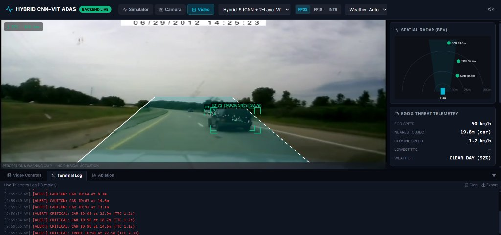
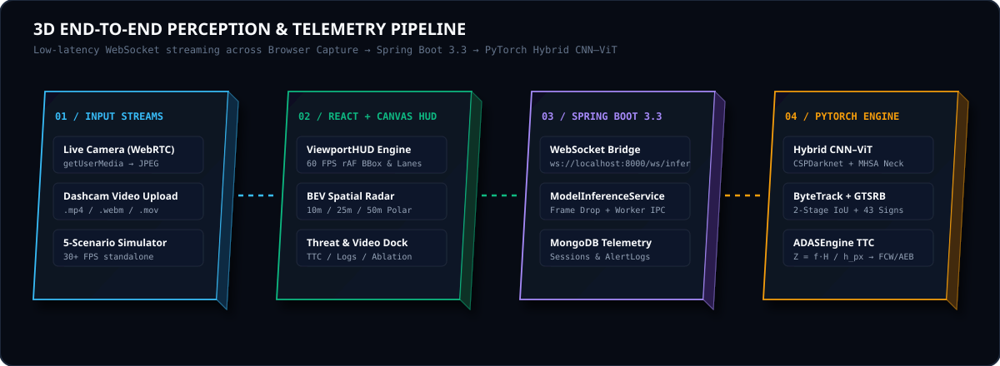

<p align="center">
  
</p>

<p align="center">
  
  
  
  
</p>

# Real-Time Hybrid CNN–Vision Transformer ADAS

A full-stack **Advanced Driver Assistance System (ADAS)** for **monocular road perception, multi-object tracking, and collision risk telemetry**. It pairs a **CSPDarknet + Windowed Multi-Head Self-Attention** detector (with pretrained YOLOv8 fallback) and **ByteTrack** tracker with a **Spring Boot 3.3 WebSocket/MongoDB backend** and a **60 FPS HTML5 Canvas + React HUD**.

---

## Live Working Dashboard

> **Video Upload & Live Camera Inference (`BACKEND LIVE`)** — Real-time bounding boxes, drivable corridor, lane markings, Bird's-Eye-View (BEV) Spatial Radar, Ego & Threat Telemetry, and live TTC collision alerts.

<p align="center">
  
</p>

---

## 3D End-to-End Architecture

<p align="center">
  
</p>

### Three Operating Modes
| Mode | How It Works |
|------|--------------|
| **Simulator** | Deterministic 5-scenario road engine (*Highway, Pedestrian Crossing, Lead-Car Brake, School Zone, Rain/Night*) running at 30+ FPS directly in the browser. |
| **Live Camera** | Captures webcam/dashcam video via `getUserMedia`, streams JPEG frames over `ws://localhost:5173/ws/infer` to Spring Boot → PyTorch, and renders live detections & BEV radar. |
| **Video Upload** | Drag-and-drop `.mp4`, `.webm`, or `.mov` dashcam clips with Play/Pause, Seek, Skip (±5s), and `0.25x–2x` speed controls synced to live backend inference. |

---

## Model Ablation & Safety Telemetry Dashboard

<p align="center">
  
</p>

| Component | Implementation |
|-----------|----------------|
| **Hybrid Vision Backbone** | `models/hybrid_model.py` — `CSPDarknetBackbone` + `TransformerNeck` (`Windowed MHSA`) + `DetectionHead` |
| **Multi-Object Tracker** | `ByteTrackTracker` (`adas_live_demo.py`) — Two-stage high/low confidence IoU association with persistent Track IDs |
| **Traffic Sign Classifier** | `models/sign_classifier.py` — 43-class GTSRB Stage-2 MobileNetV3-Small crop classifier |
| **Monocular Telemetry** | Pinhole distance estimation $Z = (f \cdot H_{\text{real}}) / h_{\text{px}}$, closing speed, and Time-To-Collision (`TTC`) |
| **Backend & Persistence** | `backend/` — Spring Boot 3.3 WebSocket (`/ws/infer`), `ModelInferenceService`, REST `/health` & `/api/telemetry`, MongoDB `TelemetrySession` & `AlertLog` |

---

## Quick Start

### 1. Start the Spring Boot Backend (Port 8000)
```powershell
npm run backend
```
*(Or `cd backend && ..\.tools\apache-maven-3.9.9\bin\mvn.cmd spring-boot:run`)*

### 2. Start the React + Vite Frontend (Port 5173)
```powershell
npm run frontend
```
*(Or `cd frontend && npm install && npm run dev`)*

Open **http://localhost:5173** in your browser.

---

## Project Documentation & Structure

- **[Web UI & Backend Guide](README_UI.md)** — Detailed frontend components, WebSocket contract, and design tokens.
- **[Data Pipeline Guide](README_DATA_PIPELINE.md)** — Dataset conversion scripts (`KITTI`, `BDD100K`, `GTSDB`, `IDD`, `DAWN`, `Waymo`) and training workflow.

```text
ADAS-CAPSTONE-/
├── docs/assets/                # Animated 3D SVG dashboards & live working screenshot
├── frontend/                   # React 18 + TypeScript + Vite + Tailwind + Canvas HUD
├── backend/                    # Spring Boot 3.3 + WebSocket + MongoDB telemetry API
├── models/                     # CSPDarknet, TransformerNeck, DetectionHead, GTSRB
├── scripts/                    # inference_worker.py, training, export & dataset converters
├── adas_live_demo.py           # ByteTrackTracker & ADASEngine monocular telemetry
└── package.json                # Root scripts (npm run frontend / npm run backend)
```
