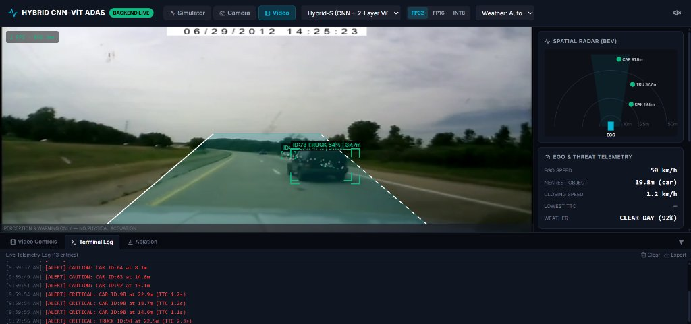

# ADAS Web UI — Setup & Usage

<p align="center">
  
</p>

## Overview

A production-grade **Real-Time ADAS Perception & Telemetry Web Application** for the
**Hybrid CNN–Vision Transformer** capstone project. The UI operates in three input modes:

| Mode | Description |
|------|-------------|
| **Live Simulator** | Built-in road simulator generating realistic detections at 30+ FPS — no GPU or camera needed |
| **Live Camera** | Webcam / dashcam feed via `getUserMedia`, frames sent to the Python backend for real inference |
| **Upload Video** | Drag-and-drop any dashcam video (`.mp4`, `.webm`, `.mov`) with full playback controls |

---

## Quick Start

### 1. Frontend (React + Vite)

```powershell
cd frontend
npm install
npm run dev
```

Open **http://localhost:5173** in your browser.

### 2. Backend (Spring Boot WebSocket + Hybrid CNN-ViT Model)

```powershell
# From the repository root (uses the included portable Maven):
npm run backend
```

Or directly from `backend/`:

```powershell
cd backend
..\.tools\apache-maven-3.9.9\bin\mvn.cmd spring-boot:run
```

The Spring Boot server runs on port **8000**, exposes the WebSocket endpoint at `ws://localhost:8000/ws/infer`, and automatically launches the Python `HybridADASModel` inference worker (`scripts/inference_worker.py` with `runs/phase1_hybrid_s/best.pt`) to process live Camera and Video frames.
Health check: `http://localhost:8000/health`.

> **Note:** The frontend works fully standalone in Simulator mode. The Spring Boot backend is used for live Camera/Video mode with real `HybridADASModel` inference (and optional MongoDB telemetry persistence at `mongodb://localhost:27017/adas_capstone`).

---

## Tech Stack

- **Frontend:** React 18 + TypeScript + Vite + Tailwind CSS + Lucide React + Recharts
- **Rendering:** HTML5 Canvas overlay via `requestAnimationFrame` (outside React state)
- **Backend:** Java 17+ / Spring Boot 3.3 + MongoDB + WebSocket bridge to PyTorch `hybrid_s` worker

---

## Project Structure

```
frontend/
├── index.html
├── package.json
├── tailwind.config.js
├── vite.config.ts
├── tsconfig.json
└── src/
    ├── main.tsx                     # Entry point
    ├── App.tsx                      # Root layout
    ├── index.css                    # Tailwind entry
    ├── types/adas.ts                # TypeScript contract (FrameInferencePayload)
    ├── engine/
    │   ├── simulator.ts             # Deterministic ADAS simulator (5 scenarios)
    │   └── canvasRenderer.ts        # High-FPS canvas drawing functions
    ├── hooks/
    │   └── useAdasStream.ts         # Unified stream manager (sim / WS / video)
    └── components/
        ├── TopBar.tsx               # Controls: mode, model, precision, weather
        ├── ViewportHUD.tsx           # Canvas viewport + overlays
        ├── BEVRadar.tsx              # Bird's-eye-view spatial radar
        ├── TelemetrySidebar.tsx      # Telemetry cards (ego, threat, latency, objects)
        └── BottomDock.tsx            # Tabs: video controls, terminal log, ablation

backend/
├── __init__.py
├── ws_server.py                     # FastAPI WebSocket server
└── requirements-ui.txt              # Python dependencies
```

---

## Simulator Scenarios

| Scenario | What it tests |
|----------|--------------|
| Normal Highway | Multi-object tracking, lane keeping |
| Pedestrian Crossing | Critical TTC alert, brake warning banner |
| Lead-Car Brake | Closing speed, TTC countdown, emergency alert |
| School Zone + Red Light | Traffic sign (GTSRB), traffic light state, low speed |
| Rain / Night Stress | Weather detection, reduced confidence, particles |

---

## WebSocket Data Contract

The frontend and backend communicate via the `FrameInferencePayload` interface.
See [`frontend/src/types/adas.ts`](frontend/src/types/adas.ts) for the full TypeScript definition.

Key fields:
- `objects[]` — Tracked detections with bbox, distance, TTC, risk level, trajectory
- `lanes[]` — Lane line splines with marking type classification
- `drivable_area_polygon_norm` — Road surface polygon
- `emergency_brake_warning` — Boolean trigger for the brake banner
- `latency_ms` — Per-stage pipeline timing breakdown

---

## Design System

| Token | Value | Usage |
|-------|-------|-------|
| Primary BG | `#080B12` | Canvas / page background |
| Card BG | `#101522` | Elevated panels |
| Border | `#1E293B` | Subtle separators |
| Safe | `#10B981` | Normal tracks, good FPS |
| Caution | `#F59E0B` | Approaching objects, moderate TTC |
| Critical | `#EF4444` | Brake warning, low TTC |
| Drivable | `#06B6D4` | Road area, ego path |
